  

 

  

 

  <samp>¡Hola! Soy <b>MIXUS</b> — software ⊹ apps ⊹ webs</samp>

 

  

 

  

 
 

<samp><b>// stack</b></samp>

 

  
  
  
  
  
  
  
  
  
  
  
  

 
 

<samp><b>// actividad</b></samp>

 

  
  

  

 
 

<samp><b>// productos</b></samp>

 

  
  

  
  

 
 

<samp><b>// contacto</b></samp>

 

  
  

 
 

  

